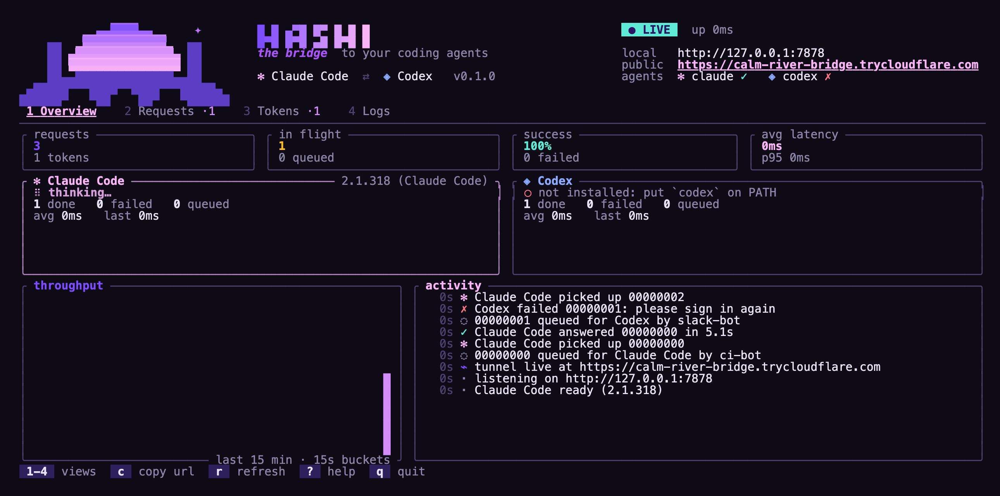

<p align="center">
  <picture>
    <source media="(prefers-color-scheme: dark)" srcset="assets/logo-dark.png">
    
  </picture>
</p>

# Hashi

**Call Claude Code, Codex and other coding agents on your machine over HTTP, and share them with people and apps without sharing your account.**

[](https://github.com/sidharthpunathil/hashi/releases/latest)
[](https://github.com/sidharthpunathil/hashi/actions/workflows/ci.yml)
[](#license)

Hashi (橋, Japanese for bridge) is a single binary that runs next to the agent CLIs you already installed and signed in to. It puts them behind one authenticated API, so a script, an app, a bot or a friend can send a prompt and get the answer back as JSON:

```bash
curl http://127.0.0.1:7878/v1/ask \
  -H "Authorization: Bearer $HASHI_TOKEN" \
  -d '{"message": "Explain what src/main.rs does", "agent": "claude", "wait": 60}'
```

```json
{
  "id": "c761eb2f-27b8-41c6-a485-8a475d7cec21",
  "agent": "claude",
  "status": "completed",
  "response": "src/main.rs parses the CLI and starts the server...",
  "usage": { "inputTokens": 36371, "outputTokens": 412, "costUsd": 0.1985 },
  "durationMs": 5132
}
```

## Why Hashi

You could hand out an API key, or let people SSH in and run `claude -p` themselves. Hashi sits between those:

- **It uses the agents, not just the models.** A prompt runs the real CLI in its own workspace, with the agent's tools, its file reading and its ongoing conversation. It runs under the plan you are already signed in to, so you need no API key per app.
- **Every person or app gets their own token.** Each token can be scoped to some agents, capped per day or month, paused, expired and revoked. Nobody gets your login or a shell of their own.
- **Your machine stays usable.** Prompts wait in a SQLite queue that survives restarts. A machine-wide run cap, a memory reserve and a per-run memory limit stop a busy sharer from swapping your laptop to death.
- **It is one file.** A Rust binary with SQLite built in, for Linux, macOS and Windows. It needs no runtime, no database server and no container.

**When not to use it.** Each answer is a full agent session, so it takes seconds to minutes and depends on one machine staying on. For high-volume or low-latency production traffic, call the provider's API. Agents run as your OS user, so share them only with people you would trust with your files ([what that means](docs/security-model.md#what-a-token-can-and-cannot-do)). Using a subscription this way is subject to each provider's terms; check yours before you share.

## Status

Early and actively developed: v0.2.0, released November 2026. CI builds and tests every commit on Linux, macOS and Windows; Windows has seen the least real use. The HTTP API may still change before 1.0, and every change is listed in the [changelog](CHANGELOG.md).

## Install

**macOS and Linux**

```bash
curl -fsSL https://raw.githubusercontent.com/sidharthpunathil/hashi/main/install.sh | sh
```

**Windows** (PowerShell)

```powershell
irm https://raw.githubusercontent.com/sidharthpunathil/hashi/main/install.ps1 | iex
```

The script downloads the build for your platform, checks its SHA-256 checksum and installs it without admin rights: to `~/.local/bin` on macOS and Linux, or `%LOCALAPPDATA%\Programs\hashi\bin` on Windows (added to your PATH). It ends by running `hashi doctor` to show which agents it found.

Other options: download an archive from the [releases page](https://github.com/sidharthpunathil/hashi/releases) (Linux x64 and ARM64, macOS Intel and Apple Silicon, Windows x64), run `cargo install --locked --git https://github.com/sidharthpunathil/hashi` (Rust 1.89 or later), or pin a version with `HASHI_VERSION` ([installer options](docs/configuration.md#installer-options)). To uninstall, delete the `hashi` binary, and `~/.hashi` if you also want to remove tokens and history.

**Updating:** run `hashi update` (the dashboard shows when a new release is out); a Cargo install updates with `cargo install --locked --git https://github.com/sidharthpunathil/hashi --force`.

## Quick start

1. **Have at least one agent installed and signed in**, for example `claude --version` or `codex --version`.

2. **Start the bridge.**

   ```bash
   hashi
   ```

   On the first start Hashi creates an admin token and shows it once. Copy it with `c` in the dashboard, or from the terminal with `--headless`.

3. **Make a token for your app and send a prompt.**

   ```bash
   export HASHI_ADMIN=hashi_...   # from step 2

   curl http://127.0.0.1:7878/v1/tokens \
     -H "Authorization: Bearer $HASHI_ADMIN" \
     -d '{"name": "my-app", "sessionMode": "stateful"}'

   curl http://127.0.0.1:7878/v1/ask \
     -H "Authorization: Bearer hashi_<the token you just got>" \
     -d '{"message": "Write a haiku about bridges", "wait": 60}'
   ```

   The first call answers with the new token in its `token` field, shown only this once. A `stateful` token picks up its conversation where it left off on every prompt. You can also make tokens from the dashboard (`3`, then `n`) or with `hashi token create my-app --stateful`.

<p align="center">
  
</p>

## Sharing with people

```bash
hashi share alice --daily-requests 50 --daily-budget 5 --expires-in-days 30
```

This prints a one-time link like `https://your-host/claim/hashi_inv_…` (for people on other machines, set up [remote access](#remote-access) first). It works once and expires after 24 hours (`--link-hours 1|24|168`). When Alice opens it, she sees who is sharing, which agents she gets, her limits, and a notice that you can see her prompts and answers. One click gives her a personal token with ready-made curl, Python, TypeScript and MCP snippets.

- **Limits.** Prompts per UTC day or month, reported spend per day or month (Claude Code and opencode report cost), and prompts in flight (3 by default). Over a cap, she gets `429 limit_reached` with the time it resets.
- **Control.** Pause, extend or revoke from the dashboard (`3`, then `p` or `d`), with `hashi token update`, or over the API. Revoking stops her running prompts at once. Every change is recorded in `hashi audit`.
- **Self-service.** `/me` is a page where she pastes her token to see her status, limits and today's use.
- **From her own agent.** Hashi is an MCP server at `/mcp`, so she can add your agents as tools in her Claude Code or Cursor. The claim page shows the exact command, plus one-click Add to Cursor and Add to VS Code buttons.
- **One command.** Instead of clicking, she can copy the setup command from the claim page: it installs Hashi from GitHub and runs `hashi connect` with her link, so `hashi ask --remote "..."` works straight away. See [connecting to someone else's Hashi](docs/configuration.md#connecting-to-someone-elses-hashi).

## Supported agents

Hashi drives whichever of these you have installed and signed in to. Each runs headless with its safest unattended setting, so a prompt cannot make it approve its own tool use.

| Agent | `agent` value | Headless defaults Hashi uses | Reports |
|---|---|---|---|
| [Claude Code](https://docs.anthropic.com/en/docs/claude-code) | `claude` | print mode, 10-turn limit, user settings only, no MCP servers, `WebFetch` denied unless you set a permission mode | tokens and cost |
| [Codex](https://github.com/openai/codex) | `codex` | `exec` with a read-only sandbox (your global MCP servers still load) | tokens |
| [Gemini CLI](https://github.com/google-gemini/gemini-cli) | `gemini` | `--approval-mode default`, so tools that need approval are denied; no MCP servers | tokens |
| [opencode](https://opencode.ai) 2.2+ | `opencode` | every tool denied except read, glob, grep, list and lsp; `.env` files unreadable; project config ignored | tokens and cost |
| [Qwen Code](https://github.com/QwenLM/qwen-code) | `qwen` | `--approval-mode default`, so shell and edits are denied; no MCP servers | tokens |
| [Cursor CLI](https://docs.cursor.com/en/cli/overview) | `cursor` | print mode with the sandbox on, never `--force`, so changes are proposed and not applied | text only |

Every agent works in its own directory per token. To loosen Claude Code or Codex, use `--claude-permission-mode` or `--codex-sandbox`; other defaults are fixed in this release. Adding an agent takes one file in `src/agent/`; see [CONTRIBUTING.md](CONTRIBUTING.md) and the [research notes](docs/research/agent-clis.md).

## Remote access

Hashi listens on `127.0.0.1` by default. To reach it from elsewhere, each of these gives you HTTPS:

| Option | Command |
|---|---|
| Cloudflare quick tunnel (random URL, new on each start) | press `t` in the dashboard, or `hashi serve --tunnel` |
| Cloudflare named tunnel (your hostname) | `HASHI_TUNNEL_TOKEN=... hashi serve --public-url https://hashi.example.com` |
| Tailscale Serve (your tailnet) or Funnel (the internet), at `https://<machine>.<tailnet>.ts.net` | `hashi serve --tailscale serve` or `--tailscale funnel`, or the Commands view (`5`) |
| Hashi serves TLS itself (LAN, Tailscale, your own certificate) | `hashi serve --tls-cert cert.pem --tls-key key.pem` |
| Behind Caddy or nginx | `hashi serve --public-url https://... --trust-proxy` |

Missing `cloudflared` or `tailscale`? `hashi install cloudflared` or `hashi install tailscale` shows the vendor's own install command for your platform and runs it after you confirm.

Setup for each, including Tailscale and mkcert certificates, is in [docs/remote-access.md](docs/remote-access.md).

## How it works

A request is checked against its token, written to SQLite and handed to that agent's worker. The worker claims it, starts the CLI directly (no shell, prompt after `--`) in the token's workspace under the resource guard, parses its output and stores the answer. Long-polling clients and the dashboard follow along on an in-process event bus. If Hashi stops mid-run, the request goes back in the queue on the next start.

## Documentation

- [API reference](docs/api.md): endpoints, request fields, MCP tools, errors, Python and TypeScript examples
- [Configuration](docs/configuration.md): every flag and environment variable, CLI commands, dashboard keys, bug reports
- [Security model](docs/security-model.md): what a token can reach, resource protection, limits, known gaps
- [Remote access and HTTPS](docs/remote-access.md)
- [Changelog](CHANGELOG.md) and [security policy](SECURITY.md)

Found a bug? `hashi report` writes a redacted diagnostic file and prints a prefilled issue link; nothing is uploaded ([details](docs/configuration.md#reporting-a-bug)).

## Contributing

Bug reports and pull requests are welcome. [CONTRIBUTING.md](CONTRIBUTING.md) covers the local setup and the checks CI runs.

## License

Dual-licensed under [MIT](LICENSE-MIT) or [Apache 2.0](LICENSE-APACHE), at your option.

Hashi is an independent project. It is not affiliated with Anthropic, OpenAI, Google, Alibaba, Anysphere or the opencode project. All product names are trademarks of their respective owners.
