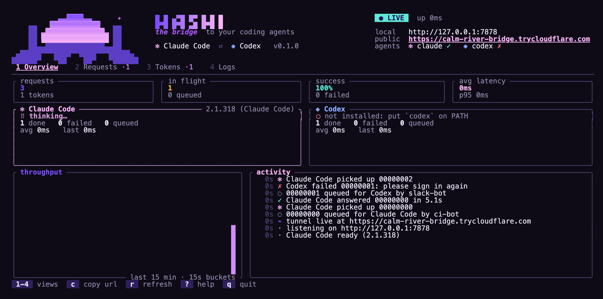

<p align="center">
  <picture>
    <source media="(prefers-color-scheme: dark)" srcset="assets/logo-dark.png">
    
  </picture>
</p>

# Hashi

**Keep several accounts for Claude Code, Codex and other coding-agent CLIs on your machine, switch between them, see what you use, and share the agents over HTTP without sharing your login.**

[](https://github.com/sidharthpunathil/hashi/releases/latest)
[](https://github.com/sidharthpunathil/hashi/actions/workflows/ci.yml)
[](#license)

## What is Hashi

Hashi (橋, Japanese for bridge) is a single binary that runs next to the agent CLIs you already installed. It does two jobs:

- **Your own accounts.** Add a work login, a personal login, an API key or a friend's bridge for each agent. `hashi switch claude work` makes the plain `claude` command sign in as `work` in every terminal and editor. `hashi account usage` shows how much of each Claude Code and Codex plan is left, and `hashi stats` shows what you used, by day, account, model and project.
- **Sharing.** `hashi` starts a server that puts the agents behind one authenticated API. A script, an app, a bot or a friend sends a prompt and gets the answer back as JSON, through a token you can limit, pause and revoke. When one account hits its limit, the prompt moves to the next.

```bash
hashi account add claude work      # a second Claude Code login, in its own directory
hashi switch claude work           # plain `claude` now signs in as work
hashi account usage --refresh      # how much of each plan is left
```

## Why Hashi

- **Switching is one command, not a sign-out.** Hashi swaps only the saved login (the Keychain entry or credentials file). Your settings, history, MCP servers, plugins and projects stay as they are, and `hashi account reset` puts everything back.
- **It runs the agents, not just the models.** Each shared prompt runs the real CLI in its own workspace, with the agent's tools and its ongoing conversation, under the plan you are already signed in to. No API key per app.
- **Everyone gets their own token.** A token can be limited to some agents, capped per day or month, paused, expired and revoked. Nobody gets your login or a shell.
- **Your machine stays usable.** Prompts wait in a SQLite queue that survives restarts, and a machine-wide run cap, a memory reserve and a per-run memory limit keep a busy friend from swapping your laptop to death.
- **It is one file.** A Rust binary with SQLite built in, for Linux, macOS and Windows. No runtime, database server or container.

**When not to use it.** Each shared answer is a full agent session, so it takes seconds to minutes and depends on one machine staying on. For high-volume or low-latency production traffic, call the provider's API. Agents run as your OS user, so share them only with people you would trust with your files ([what that means](docs/security-model.md#what-a-token-can-and-cannot-do)). Using a subscription this way is subject to each provider's terms; check yours before you share.

## Status

Early and actively developed: v0.4.5, released November 2026. CI builds and tests every commit on Linux, macOS and Windows; Windows has seen the least real use. The HTTP API may still change before 1.0, and every change is in the [changelog](CHANGELOG.md).

## Install

**macOS and Linux**

```bash
curl -fsSL https://raw.githubusercontent.com/sidharthpunathil/hashi/main/install.sh | sh
```

**Windows** (PowerShell)

```powershell
irm https://raw.githubusercontent.com/sidharthpunathil/hashi/main/install.ps1 | iex
```

The script downloads the build for your platform, checks its SHA-256 checksum, installs it without admin rights (to `~/.local/bin`, or `%LOCALAPPDATA%\Programs\hashi\bin` on Windows, added to your PATH) and runs `hashi doctor` to show which agents it found. Pin a release with `HASHI_VERSION=v0.4.5` ([installer options](docs/configuration.md#installer-options)).

The checksum proves the download arrived intact, not who built it. Every release archive also has a GitHub build attestation tying it to this repository's release workflow. Check one with the [GitHub CLI](https://cli.github.com):

```bash
gh attestation verify hashi-aarch64-apple-darwin.tar.gz --repo sidharthpunathil/hashi
```

You can also download an archive from the [releases page](https://github.com/sidharthpunathil/hashi/releases) (Linux x64 and ARM64, macOS Intel and Apple Silicon, Windows x64) or build with `cargo install --locked --git https://github.com/sidharthpunathil/hashi` (Rust 1.89 or later). `hashi update` installs a new release and `hashi uninstall` removes Hashi and its data.

## Quick start

Have at least one agent installed and signed in, for example `claude --version` or `codex --version`.

**Use a second account in your own terminal.**

```bash
hashi account add claude work    # prints the sign-in command and runs it after you confirm
hashi switch claude work         # plain `claude` is now the work account
hashi switch claude              # who plain `claude` signs in as, with the email
hashi switch claude default      # back to your own login
```

**Share an agent over HTTP.**

1. Start the bridge:

   ```bash
   hashi
   ```

   On the first start Hashi creates an admin token and shows it once. Copy it with `c` in the dashboard, or run `hashi serve --headless` to get it in the terminal.

2. Make a token for your app and send a prompt:

   ```bash
   export HASHI_ADMIN=hashi_...   # from step 1

   curl http://127.0.0.1:7878/v1/tokens \
     -H "Authorization: Bearer $HASHI_ADMIN" \
     -d '{"name": "my-app", "sessionMode": "stateful"}'

   curl http://127.0.0.1:7878/v1/ask \
     -H "Authorization: Bearer hashi_<the token you just got>" \
     -d '{"message": "Write a haiku about bridges", "agent": "claude", "wait": 60}'
   ```

   The first call answers with the new token in its `token` field, shown only this once. A `stateful` token picks up its conversation where it left off. `hashi token create my-app --stateful` does the same from a terminal. The answer looks like this:

   ```json
   {
     "id": "c761eb2f-27b8-41c6-a485-8a475d7cec21",
     "agent": "claude",
     "status": "completed",
     "response": "Steel spans the river...",
     "usage": { "inputTokens": 36371, "outputTokens": 412, "costUsd": 0.1985 },
     "durationMs": 5132
   }
   ```

## Accounts and switching

An account is another login, an API key, a Claude Code OAuth token (from `claude setup-token`) or a friend's bridge, for one agent:

```bash
hashi account add claude work                          # a login, in ~/.hashi/accounts/claude/work/
hashi account add codex ci --key-env CI_KEY            # an API key
hashi account add claude bot --kind oauth-token --key-stdin
hashi account add claude bob-claude --remote bob       # a friend's bridge (see Sharing)
hashi account list
```

Your own login stays the `default` account and is never touched unless you switch.

**Switching the plain CLI.** `hashi switch <agent> <name>` points the normal command at one of your login accounts, so typing `claude` in any terminal or editor uses it, with no alias and no variable. `hashi switch claude default` puts your original login back, and `hashi switch claude` shows who is signed in, with the email. Hashi swaps only the saved login and keeps the one it leaves where it belongs. `w` in the dashboard's Accounts popup does the same.

- Running sessions keep their login until they restart.
- The Claude desktop app is not switched; it has its own sign-in.
- It works for `claude`, `codex`, `gemini`, `opencode`, `grok`, `kimi`, `kilo`, `cline`, `crush`, `pi`, `devin`, `hermes`, `mimo`, `prime`. An agent that keeps its login in the OS keyring, encrypted or inside its settings cannot be switched and says why ([coverage](docs/agent-coverage.md)). Only login accounts can be switched to (not keys, tokens or remote accounts).
- `hashi account reset` puts everything back: the plain CLIs on your own logins, Hashi's saved copies of them deleted, and every command Hashi wrote removed. Your accounts stay.

**A command that skips permission prompts.** Nothing is set up by default. Pick the word yourself and Hashi writes a small script by that name next to `hashi` on your PATH:

```bash
hashi account commands --agent claude --name dclaude   # dclaude = claude --dangerously-skip-permissions
hashi account commands --agent codex --name dcodex     # codex --dangerously-bypass-approvals-and-sandbox
hashi account commands --agent claude --name ''        # remove it
```

It runs the plain CLI, so it follows `hashi switch`. Details are in [accounts](docs/configuration.md#accounts).

**What is left on each plan.** Hashi reads how much of each Claude Code and Codex plan is left, every five minutes while the server runs and after each run, or now with `--refresh`, without spending a token or refreshing a login:

```console
$ hashi account usage
claude:work  max  28% left  (poll, 2m ago)
  5 hours        ██████░░░░░░░░░░░░░░  31%  resets in 2h 9m (2026-11-06T23:37:22Z)
  week           ██████████████░░░░░░  72%  resets in 3d 11h (2026-11-09T09:27:22Z)
codex:default  plus  9% left (warning)  (poll, 1m ago)
  5 hours        ██████████████████░░  91%  resets in 49m (2026-11-06T22:17:22Z)
  week           ████████░░░░░░░░░░░░  40%  resets in 4d 15h (2026-11-10T12:34:02Z)
```

Other agents and API keys show `unknown`, with their runs and reported cost today.

**Failover.** Shared runs use an agent's accounts in a list you choose (per token, invite or project). When a run fails with the agent's usage limit message, that account is marked limited until its reset and the prompt moves to the next account. How the next account is chosen is a strategy, set per project (`--account-strategy` on `hashi project add`) or for the server (`hashi serve --account-strategy`):

- `in-order` (the default): the first account in the list that is not at its limit.
- `most-left`: the account with the most quota left.
- `soonest-reset`: the account whose weekly quota resets soonest, so quota that would expire unused is spent first.

With any strategy, runs move off an account once it is 90% used (`--rotate-at`, 50 to 99). See [usage and strategies](docs/configuration.md#usage-and-strategies).

## Your own usage

Hashi can also count your own interactive Claude Code use, not just what it runs for others. It is off until you turn it on:

```bash
hashi stats on            # start counting
hashi stats               # the report for the last 7 days
hashi stats --days 30     # a longer window
hashi stats --json        # the same as JSON
hashi stats off           # stop counting
hashi stats forget        # delete the numbers collected so far
```

Hashi reads Claude Code's own session files on this machine and keeps numbers only: tokens, the model, the project folder's name, and an estimated cost from list prices. It never stores prompt or answer text, and nothing leaves your machine. The report shows:

- totals and estimated cost by day, account, model and project;
- quota burn, with a forecast of when an account's 5-hour or weekly window runs out at the current pace;
- you against shared: your own CLI use next to what Hashi ran for tokens and friends on each account.

In the dashboard, the Commands view has a "My usage" row: `t` turns tracking on or off, `d` switches between 1, 7 and 30 days, and `f` forgets the numbers. Details are in [your own usage](docs/configuration.md#your-own-usage).

## Sharing and the API

**Invite a person.**

```bash
hashi share alice --daily-requests 50 --daily-budget 5 --expires-in-days 30
```

This prints a one-time link, `https://your-host/claim/hashi_inv_…`, that works once and expires after 24 hours (for people on other machines, set up [remote access](#remote-access) first). Alice's page shows who is sharing, which agents she gets, her limits and a notice that you can see her prompts and answers. One click gives her a personal token with curl, Python, TypeScript and MCP snippets. Or she copies one setup command that installs Hashi and runs `hashi connect`, after which `hashi ask --remote "..."` works from her terminal. Pause, edit or revoke her token from the dashboard, `hashi token update` or `hashi token revoke`; revoking stops her running prompts at once, and every change is in `hashi audit`.

Other ways to share:

- **Access requests.** `hashi requests open` makes a link where people ask for access; `hashi requests accept` or `decline` decides. Nothing is granted without you ([access requests](docs/configuration.md#access-requests)).
- **Login share.** `hashi share-login dana --account claude:bot --remind-at 70 --days 7` hands someone you trust the key of an API-key or OAuth-token account, so they run the agent on their own machine. Nothing is enforced after that; both of you get a reminder at the percent you set, and their copy is switched off when the days end.
- **Pools.** `hashi pool open` makes one join link; each member's Hashi pulls prompts from the host and runs them with its own accounts and limits, so members need no public URL and their keys never leave their machine.
- **Friends' bridges as your accounts.** `hashi connect <link>` saves a friend's Hashi as a remote, and `hashi account add claude bob-claude --remote bob` makes it one of your accounts. If his bridge is down or his limits are reached, the prompt moves to your next account. Bob sees every prompt sent through it ([remote accounts](docs/configuration.md#remote-accounts)).

**Projects.** A project is a folder that tokens and invites run in, instead of a private workspace:

```bash
hashi project add api ~/code/api --account claude=work,default --model claude=sonnet
hashi share alice --project api
```

Alice sees only the project's name, never its folder or your account names, and Hashi never changes, moves or deletes a project folder. A project changes where a run starts, not what an agent running as you can read, so share only folders you trust people with ([projects](docs/configuration.md#projects)).

**OpenAI-compatible API and MCP.** Hashi also speaks the OpenAI chat API at `/v1/chat/completions` and `/v1/models`, so the `openai` packages, Open WebUI and other tools built for it work with a Hashi token. Point them at `http://127.0.0.1:7878/v1`, use your `hashi_...` token as the API key, and pick an agent as the model: `claude`, `codex`, or `claude/opus` to choose the agent's own model. `stream: true` works, but the answer arrives as one chunk because agents do not stream token by token. `POST /mcp` is an MCP server with an `ask_<agent>` tool per agent. See the [API reference](docs/api.md).

## The dashboard

`hashi` with no command starts the server and opens a terminal dashboard with five views: Overview, Requests, Tokens, Logs and Commands. It does nearly everything the CLI does: tokens, invites, accounts and switching, projects, your usage, going public, moving the server to another port, the audit log and updates. Tab `5` lists every action with the command that does the same, and `?` shows every key ([dashboard keys](docs/configuration.md#dashboard-keys)).

<p align="center">
  
</p>

## Supported agents

Hashi drives whichever of these you have installed and signed in to. Each runs headless with its safest unattended setting, so a prompt cannot make it approve its own tool use. A few agents run shell or write tools without asking whatever Hashi passes; they are marked **Opt-in** below and stay off until you name them in `--enable-agents`, because anyone with a token for one can run commands as you. The first six have been used the most; the rest were built from each CLI's source or docs ([research notes](docs/research/agent-clis.md#table-driven-agents-2026-11-16)) and are newer.

| Agent | `agent` value | Headless defaults Hashi uses | Reports | Verified with |
|---|---|---|---|---|
| [Claude Code](https://docs.anthropic.com/en/docs/claude-code) | `claude` | print mode, 10-turn limit, user settings only, no MCP servers, `WebFetch` denied unless you set a permission mode | tokens and cost | 2.1.322 (2026-11-11) |
| [Codex](https://github.com/openai/codex) | `codex` | `exec` with a read-only sandbox (your global MCP servers still load) | tokens | 0.166.0 (2026-11-06) |
| [Gemini CLI](https://github.com/google-gemini/gemini-cli) | `gemini` | `--approval-mode default`, so tools that need approval are denied; no MCP servers | tokens | 0.67.0 (2026-11-06) |
| [opencode](https://opencode.ai) 2.2+ | `opencode` | every tool denied except read, glob, grep, list and lsp; `.env` files unreadable; project config ignored | tokens and cost | 2.2.7 (2026-11-11) |
| [Qwen Code](https://github.com/QwenLM/qwen-code) | `qwen` | `--approval-mode default`, so shell and edits are denied; no MCP servers | tokens | 0.27.2 (2026-11-11) |
| [Cursor CLI](https://docs.cursor.com/en/cli/overview) | `cursor` | print mode with the sandbox on, never `--force`, so changes are proposed and not applied | text only | 2026.11.05-86047df (2026-11-06) |
| [Copilot CLI](https://github.com/features/copilot/cli) | `copilot` | `--output-format json`, pins `--no-ask-user`, `--no-auto-update`, `--disable-builtin-mcps` and more; agent flags that approve tools are stripped. | tokens | 1.0.112 (2026-11-16) |
| [Grok Build](https://x.ai) | `grok` | `--output-format json`, pins `--permission-mode`, `--tools`, `--disable-web-search` and more; agent flags that approve tools are stripped. | text only | 0.2.20 (2026-11-16) |
| [Antigravity](https://antigravity.google) | `antigravity` | `--output-format json`, pins `--settings={"agentMode":""}`, `--disable-slash-commands`; agent flags that approve tools are stripped. | text only | 1.5.9 (2026-11-16) |
| [Goose](https://github.com/block/goose) | `goose` | `run -q --output-format stream-json`, pins `--no-profile`; agent flags that approve tools are stripped. | tokens and cost | 1.58.0 (2026-11-16) |
| [Amp](https://ampcode.com) | `amp` | `--stream-json`, pins `--no-ide`, `--no-notifications`, `--no-remote-control-terminal`; agent flags that approve tools are stripped. **Opt-in** (`--enable-agents amp`): it can run shell or write tools without asking. | text only | 0.0.1794816357 (2026-11-16) |
| [Factory Droid](https://factory.ai) | `droid` | `exec -o json`, pins `--remove-tools`; agent flags that approve tools are stripped. **Opt-in** (`--enable-agents droid`): it expands `/command` anywhere in a prompt, which runs your custom commands and skills. | tokens | 1.12.1 (2026-11-16) |
| [Kimi Code](https://github.com/MoonshotAI/kimi-code) | `kimi` | `--output-format stream-json`; agent flags that approve tools are stripped. **Opt-in** (`--enable-agents kimi`): it can run shell or write tools without asking. | text only | 2.6.2 (2026-11-16) |
| [Kilo Code CLI](https://github.com/Kilo-Org/kilocode) | `kilo` | `run --format json`; agent flags that approve tools are stripped. | tokens and cost | 7.8.28 (2026-11-16) |
| [Cline CLI](https://github.com/cline/cline) | `cline` | `--json`, pins `--auto-approve`; agent flags that approve tools are stripped. | tokens and cost | 3.0.74 (2026-11-16) |
| [Crush](https://github.com/charmbracelet/crush) | `crush` | `run -q`; agent flags that approve tools are stripped. **Opt-in** (`--enable-agents crush`): it can run shell or write tools without asking. | text only | 0.100.0 (2026-11-16) |
| [Aider](https://github.com/Aider-AI/aider) | `aider` | `one-shot`, pins `--chat-mode`, `--yes-always`, `--no-git` and more; agent flags that approve tools are stripped. | text only | 0.86.3 (2026-11-16) |
| [Continue CLI](https://github.com/continuedev/continue) | `continue` | `-p`, pins `--exclude`; agent flags that approve tools are stripped. | text only | 1.5.47 (2026-11-16) |
| [Pi](https://github.com/badlogic/pi-mono) | `pi` | `-p --mode json`, pins `--tools`, `--no-extensions`, `--no-mcp` and more; agent flags that approve tools are stripped. | tokens and cost | 1.5.2 (2026-11-16) |
| [oh-my-pi](https://github.com/can1357/oh-my-pi) | `omp` | `-p --mode json`, pins `--approval-mode`, `--no-extensions`, `--no-skills` and more; agent flags that approve tools are stripped. | tokens and cost | 18.20.3 (2026-11-16) |
| [OpenClaude](https://github.com/Gitlawb/openclaude) | `openclaude` | `-p --output-format json`, pins `--setting-sources`, `--strict-mcp-config`, `--disallowedTools`; agent flags that approve tools are stripped. | tokens and cost | 0.36.0 (2026-11-16) |
| [CodeBuddy Code](https://www.codebuddy.ai) | `codebuddy` | `-p --output-format stream-json`, pins `--permission-mode`; agent flags that approve tools are stripped. | tokens | 2.184.0 (2026-11-16) |
| [Qoder CLI](https://qoder.com) | `qoder` | `-p --output-format json`; agent flags that approve tools are stripped. | tokens | 1.1.89 (2026-11-16) |
| [Qoder CN](https://qoder.com) | `qoder-cn` | `-p --output-format json`; agent flags that approve tools are stripped. | tokens | 1.1.89 (2026-11-16) |
| [Kiro CLI](https://kiro.dev) | `kiro` | `chat --no-interactive`, pins `--wrap`; agent flags that approve tools are stripped. | text only | 3.3.0 (2026-11-16) |
| [Auggie](https://www.augmentcode.com) | `auggie` | `--print --quiet --output-format json`, pins `--disable-process-tools`, `--remove-tool`, `--remove-tool` and more; agent flags that approve tools are stripped. **Opt-in** (`--enable-agents auggie`): it can run shell or write tools without asking. | tokens | 0.37.1 (2026-11-16) |
| [Devin CLI](https://devin.ai) | `devin` | `one-shot`, pins `--permission-mode`, `--respect-workspace-trust`, `--verbosity`; agent flags that approve tools are stripped. | text only | 3000.12.57 (2026-11-16) |
| [Rovo Dev](https://www.atlassian.com/software/rovo-dev) | `rovodev` | `rovodev run`; agent flags that approve tools are stripped. **Opt-in** (`--enable-agents rovodev`): it can run shell or write tools without asking. | text only | 1.3.40 (2026-11-16) |
| [Mistral Vibe](https://github.com/mistralai/mistral-vibe) | `vibe` | `--output streaming`, pins `--agent`; agent flags that approve tools are stripped. | text only | 3.1.2 (2026-11-16) |
| [Hermes Agent](https://github.com/NousResearch/hermes-agent) | `hermes` | `chat --format stream-json`, pins `--toolsets=todo`, `--ignore-rules`, `--source=tool`; agent flags that approve tools are stripped. | tokens | 0.23.1 (2026-11-16) |
| [OpenClaw](https://github.com/openclaw/openclaw) | `openclaw` | `agent exec --json`; agent flags that approve tools are stripped. **Opt-in** (`--enable-agents openclaw`): it can run shell or write tools without asking. | text only | 2026.11.4 (2026-11-16) |
| [Jcode](https://github.com/1jehuang/jcode) | `jcode` | `run --ndjson`, pins `--no-update`, `--quiet`, `--tools=read,ls,agentgrep`; agent flags that approve tools are stripped. **Opt-in** (`--enable-agents jcode`): it can run shell or write tools without asking. | tokens | 0.99.1 (2026-11-16) |
| [MiMo Code](https://github.com/XiaomiMiMo/MiMo-Code) | `mimo` | `run --format json`; agent flags that approve tools are stripped. **Opt-in** (`--enable-agents mimo`): it can run shell or write tools without asking. | tokens and cost | 0.1.17 (2026-11-16) |
| [Ante](https://github.com/AntigmaLabs/ante) | `ante` | `--output-format json`, pins `--permission-mode`, `--disable-auto-memory`; agent flags that approve tools are stripped. | tokens | 0.3.5 (2026-11-16) |
| [TRAE CLI](https://www.trae.ai) | `trae` | `-p --output-format stream-json`; agent flags that approve tools are stripped. | text only | 0.121.3 (2026-11-16) |
| [Muse Code](https://ai.meta.com) | `muse` | `exec --json`; agent flags that approve tools are stripped. **Opt-in** (`--enable-agents muse`): it can run shell or write tools without asking. | tokens | 1.4.20 (2026-11-16) |
| [DeepSeek](https://github.com/deepseek-ai/deepseek-harness) | `deepseek` | `headless --json`, pins `--approval-policy`; agent flags that approve tools are stripped. **Opt-in** (`--enable-agents deepseek`): it can run shell or write tools without asking. | text only | 0.2.2 (2026-11-16) |
| [ZCode](https://github.com/zai-org/ZCode) | `zcode` | `--output-format stream-json --no-color`, pins `--mode`; agent flags that approve tools are stripped. | text only | 3.18.2 (2026-11-16) |
| [Prime Agent](https://github.com/PrimeIntellect-ai/prime-agent) | `prime` | `--mode json`, pins `--no-skills`, `--no-prompt-templates`; agent flags that approve tools are stripped. **Opt-in** (`--enable-agents prime`): it can run shell or write tools without asking. | tokens and cost | 0.10.3 (2026-11-16) |
| [Autohand Code](https://github.com/autohandai/code-cli) | `autohand` | `--json local`, pins `--no-daemon`; agent flags that approve tools are stripped. | text only | 0.9.11 (2026-11-16) |
| [Command Code](https://commandcode.ai) | `command-code` | `--output-format json`, pins `--no-auto-update`, `--skip-onboarding`; agent flags that approve tools are stripped. | text only | 1.89.1 (2026-11-16) |

"Verified with" is the upstream release whose headless flags, environment variables, account isolation and limit messages were last checked, recorded in [`verified-versions.json`](docs/research/verified-versions.json). A newer release usually works; `hashi doctor` says when yours is newer, and a weekly check opens an issue for each new release.

Live quota figures are read for Claude Code and Codex only; for the others a run that hits a limit marks the account limited. Which agents support login accounts, key accounts, status checks and `hashi switch` is in the [agent coverage](docs/agent-coverage.md) table. To loosen Claude Code or Codex for shared runs, use `--claude-permission-mode` or `--codex-sandbox`; the other defaults are fixed in this release.

## Remote access

Hashi listens on `127.0.0.1` by default. Each of these gives you HTTPS from elsewhere:

| Option | Command |
|---|---|
| Cloudflare quick tunnel (random URL, new on each start) | press `t` in the dashboard, or `hashi serve --tunnel` |
| Cloudflare named tunnel (your hostname) | `HASHI_TUNNEL_TOKEN=... hashi serve --public-url https://hashi.example.com` |
| Tailscale Serve (your tailnet) or Funnel (the internet) | `hashi serve --tailscale serve` or `--tailscale funnel` |
| Hashi serves TLS itself (LAN, your own certificate) | `hashi serve --tls-cert cert.pem --tls-key key.pem` |
| Behind Caddy or nginx | `hashi serve --public-url https://... --trust-proxy` |

Missing `cloudflared` or `tailscale`? `hashi install cloudflared` or `hashi install tailscale` shows the vendor's own install command and runs it after you confirm. Setup for each option is in [docs/remote-access.md](docs/remote-access.md).

## Documentation and contributing

- [Configuration](docs/configuration.md): every flag and environment variable, CLI commands, accounts, dashboard keys
- [API reference](docs/api.md): every endpoint, request field, MCP tool and error, with Python and TypeScript examples
- [Security model](docs/security-model.md): what a token can reach, [resource protection](docs/security-model.md#protecting-your-machine), limits, known gaps
- [Remote access and HTTPS](docs/remote-access.md)
- [Performance](docs/performance.md): measurements and how to reproduce them
- [Changelog](CHANGELOG.md) and [security policy](SECURITY.md)
- `hashi doctor` checks the agents, cloudflared, Tailscale, accounts and updates, and changes nothing
- Give an LLM agent `hashi llm` and it can run Hashi for you

Bug reports and pull requests are welcome: [CONTRIBUTING.md](CONTRIBUTING.md) covers the local setup and the checks CI runs. Found a bug? `hashi report` writes a redacted diagnostic file and prints a prefilled issue link; nothing is uploaded ([details](docs/configuration.md#reporting-a-bug)).

## License

Dual-licensed under [MIT](LICENSE-MIT) or [Apache 2.0](LICENSE-APACHE), at your option.

Hashi is an independent project. It is not affiliated with Anthropic, OpenAI, Google, Alibaba, Anysphere or the opencode project. All product names are trademarks of their respective owners.
